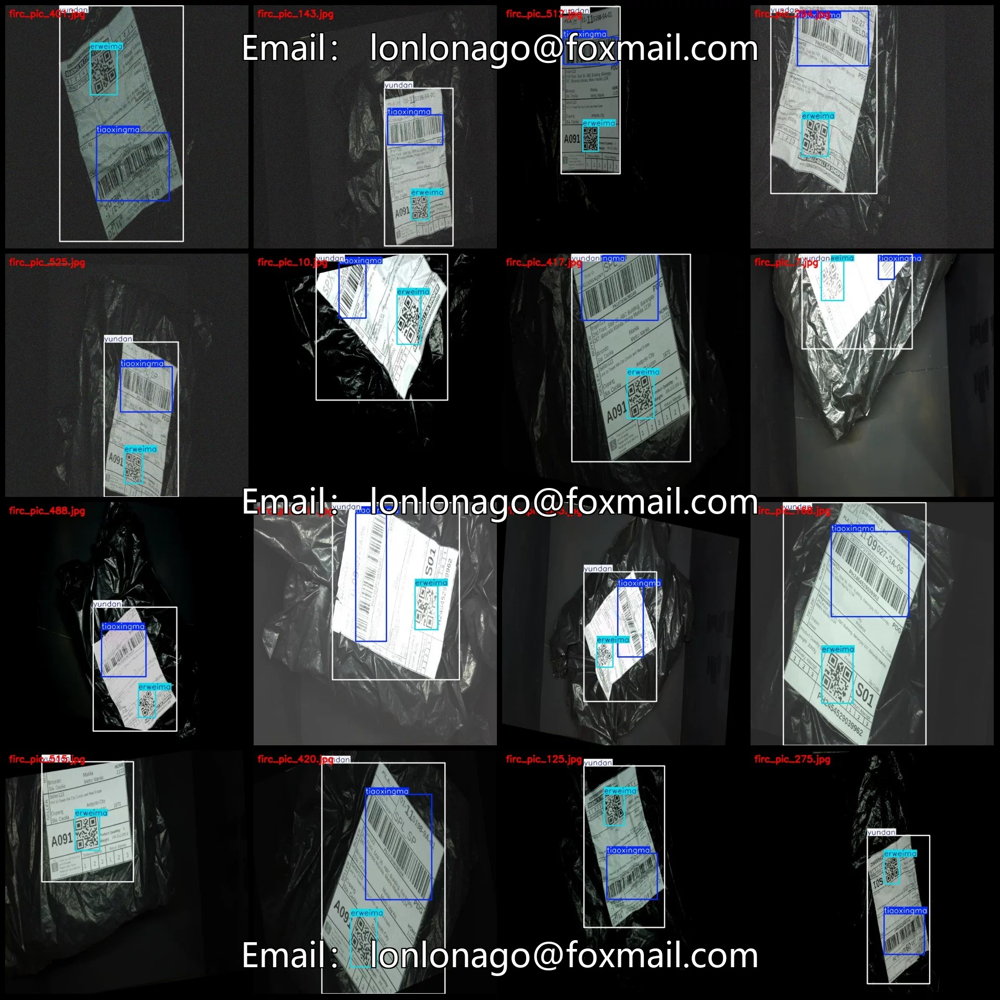
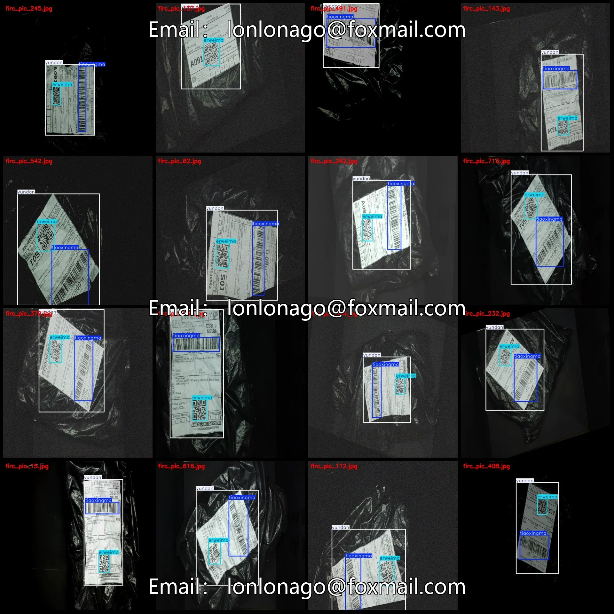
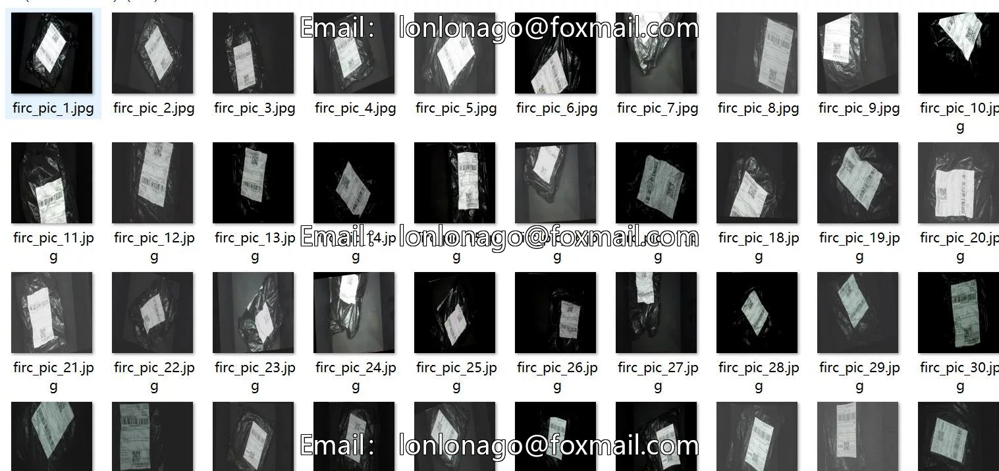
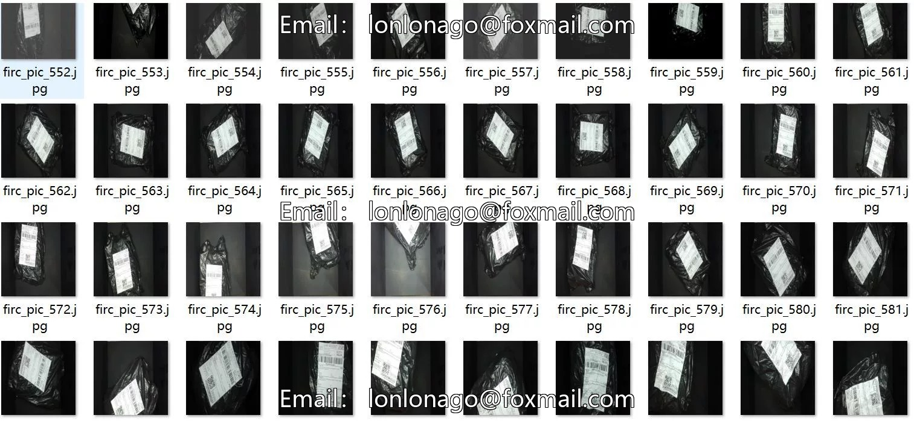
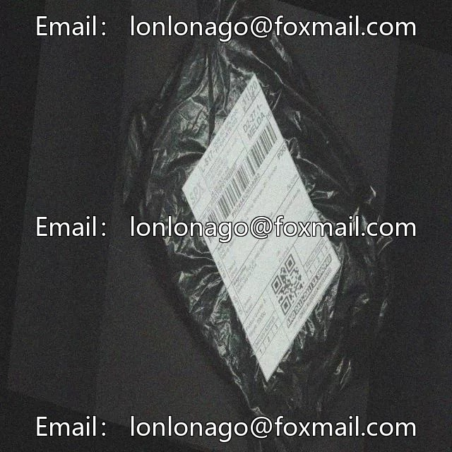
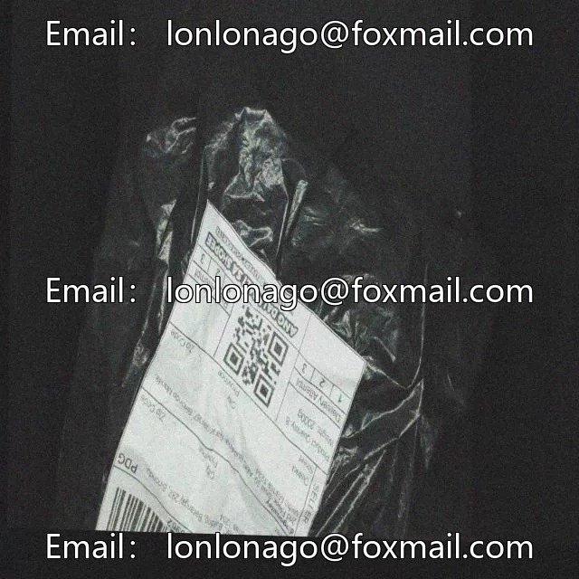
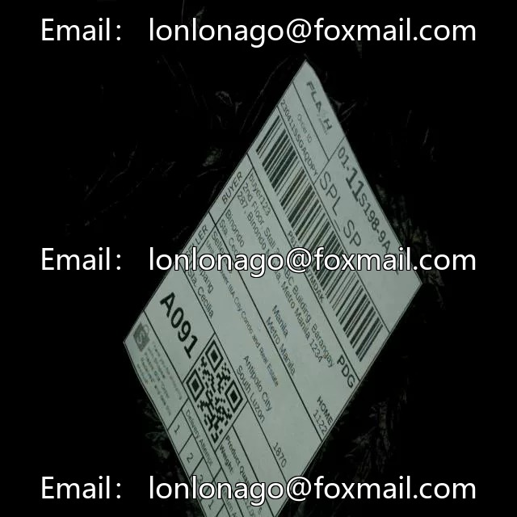

# 735 VOC+YOLO format dataset with 3 categories and increased number of samples

## Body

Delivery Label Elements Detection Dataset VOC+YOLO format with 735 images in 3 categories enhanced
Warm Reminder: Due to the dataset's replicability, please confirm compliance before purchasing.
Note: There are a large number of enhanced images in the dataset, estimated to be around 300 original images based on visual inspection.
Dataset Format: Pascal VOC format + YOLO format (txt file without segmentation paths, only containing jpg images and corresponding VOC format xml files and yolo format txt files)
Number of Images (Total jpg files): 735
Number of Annotations (Total xml files): 735
Number of Annotations (Total txt files): 735
Number of Annotation Categories: 3

Label Category Names (Note: The order of labels in the Yolo format does not correspond to this, but is based on the classes.txt file in the labels folder): ["erweima", "tiaoxingma", "yundan"]

Each category labeled boxes:
- erweima = 706
- tiaoxingma = 729
- yundan = 748
Total Boxes: 2183

Number of images per category:
- erweima = 706
- tiaoxingma = 717

Yundan occupies 735 images
Image resolution: 640x640
Labeling tool used: labelImg
Labeling rules: Draw a rectangle around the category.
Important note: The dataset does not include splits for training, validation, or testing; you must do this yourself.
Special statement: This dataset does not guarantee the accuracy of the trained models or weight files.

## Images

## Payment

Here is a pay link on Stripe ( https://buy.stripe.com/3cs8yP7sY87d0vu9AB ). Please contact me lonlonago@foxmail.com after funding $89, and I will send you a complete data files , thank you!

